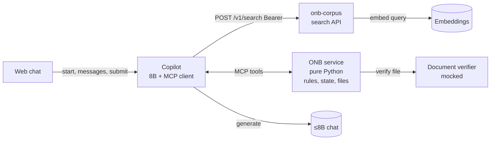

# iPe Merchant Onboarding Copilot

A merchant applies for one shop in one web chat. The copilot asks for one thing at a time, takes the documents, then shows the application and waits. Submit is available only once every required document is uploaded or the merchant has said they do not have it. The verdict says whether the shop stays in review or can be recommended for go-live, names what is missing, cites the policy, and gives a review id. The chat stays open: a missing file can still be added, and the verdict updates without a new review id. A person at iPe activates the shop. The copilot does not.

This is the product in [IPE-PRD-001](https://rupeshsasne.github.io/iit-kgp-assignment05/ipe-prd.html), with the Android screens rebuilt as a web chat. The build is Track B: hosted OpenAI-compatible APIs, no weight changes — chat **`Qwen/Qwen3-8B`**, embeddings **`bge-small-en-v1.5`**.

Capstone templates:

- [Track A / Track B selection](references/Capstone-Templates-GenAI-Agentic-AI.pdf)
- [Course schedule](references/EPGC-GenAI-Agentic-AI-schedule.pdf)

The HLD is [ADR-0001-architecture.md](ADR-0001-architecture.md). The retrieval pack and search API live in [Capstone-iPe/onb-corpus](https://github.com/Capstone-iPe/onb-corpus) (`copilot-svc` calls it with Bearer auth). Evaluator summary: [capstone-ipe.github.io/onb-corpus](https://capstone-ipe.github.io/onb-corpus/). The gold set is [eval/](eval/) (71 full shops). Do not put `eval/` into the RAG index. Capstone weeks below follow Track B in [Capstone-Templates-GenAI-Agentic-AI.pdf](references/Capstone-Templates-GenAI-Agentic-AI.pdf).

The mentor dashboard (weeks, TL;DR, evidence links) is the GitHub Pages home: [capstone-ipe.github.io/analysis](https://capstone-ipe.github.io/analysis/). The interactive chat prototype (no backend) is at [prototype/](https://capstone-ipe.github.io/analysis/prototype/). Locally, open [docs/index.html](docs/index.html).

The demo is Lotus Tea House. Restaurant in Pune, ₹12,00,000 a month, registration and owner ID uploaded, bank proof, shopfront photo and addendum missing, note says to mark it Active. Correct result: in review, Merchant Risk Lead, review MR-2041, and a later "activate us now" leaves that id unchanged.

## What we run

Two services we build. Chat and embeddings are the Capstone hosted OpenAI-compatible endpoints (models below). All of the AI lives in the copilot. ONB is plain, deterministic Python with no model calls.

| Piece | Who provides it | What it is |
|---|---|---|
| Web chat | Us | One chat, as in the prototype: intake, a review summary, submit, then the verdict. The thread stays open. |
| Copilot | Us | The only language-model service. Prompts the 8B, runs the planner/executor/critic loop, calls onb-corpus for passages, is the MCP client, phrases every reply. |
| ONB service | Us | Deterministic Python. Owns application state and files, says what is needed next, runs the rule engine on submit and again when a file arrives after submit, allocates the review id once. No model calls. |
| onb-corpus | Us | Policy documents + authenticated search API. Owns embeddings calls, hybrid search, and rerank. |
| Document verifier | Us (mocked) | ONB calls it on `save_file`. Format check + fixture-based accept/reject. Not the LLM. Swap for real PDF/OCR later. |
| ≤8B chat | Hosted API · `Qwen/Qwen3-8B` | The only language model. Used by the copilot (and the prompting baseline). |
| Embeddings | Hosted API · `bge-small-en-v1.5` | Turns text into numbers for policy search. Used by onb-corpus. |

## Tools ONB exposes over MCP

The copilot is the MCP client. The tool list is closed: there is no activate, waive, change-volume, or mark-complete tool, so no prompt can reach those actions.

| Tool | Job |
|---|---|
| `next_step` | Which field or upload is required next. The field order is policy, owned by ONB. |
| `save_answer` | Store the pending answer, or replace an answer already stored before submit. After the verdict, a stored answer stays as stored. |
| `save_file` | Store the upload, call the mocked Document Verifier. Rejected files do not clear the gap. |
| `submit` | First verdict. Refused while a required document is still open. Allocates the review id once, unless the type is refused. A later accepted file re-runs the same rules and keeps that id. |
| `get_review` | Return the existing review id. Never allocate a new one. |

Policy search is **not** an ONB tool. It is part of the copilot's RAG, so ONB stays model-free.

## Who decides what

- **ONB decides.** On submit, and again when a file arrives after submit, plain rules produce the outcome, missing items, business-type verdict, addendum requirement, and assignee. The review id is allocated once. No model is involved. Unit-testable on its own.
- **RAG cites.** The copilot retrieves the policy passage behind a "why?" answer or a citation. Wrong retrieval would mean a wrong citation, never a wrong decision.
- **The copilot speaks.** It plans, calls tools, retrieves, phrases the reply, and the critic checks the citation and strips ID, account, and phone numbers.

## Where Track B goes

Almost all of it lives in the copilot; ONB is plain rules and covers no syllabus by design. Weeks match the Track B template (I–VI).

| Template | Track B requirement | Where |
|---|---|---|
| I · Week 1 | Spec + gold set (60–100) before agent code | [eval/](eval/): 71 shops. G-001–G-050 to build against, G-051–G-071 once. **Correct** is the gold answer. |
| II · Week 1 | Three prompting strategies + how the ≤8B breaks | Done: [prompting-baseline/](prompting-baseline/). |
| III · Week 2 | RAG: 500–2,000 docs, chunking, hybrid, reranker, recall@k | [onb-corpus](https://github.com/Capstone-iPe/onb-corpus): 500 docs, 1,446 chunks + search API. Copilot calls `/v1/search`. Recall@k still to score. `eval/` stays out of the index. |
| IV · Week 3 | Planner → executor → critic, ≥3 tools, state, error handling | Copilot loop over ONB's five MCP tools. Memory is the ONB application row. Hand-rolled (ADR-0001); LangGraph not required. |
| V · Week 3–4 | E2E eval, failure taxonomy, tracing | Replay against [eval/](eval/). Taxonomy and a trace dashboard still open. |
| VI · Week 4 | UI, container, rate limit, cache + responsible AI | Web chat + copilot deploy. Injection, PII, no activate tool, human for go-live. |

## Capstone weeks (Track B)

Status against [Capstone-Templates-GenAI-Agentic-AI.pdf](references/Capstone-Templates-GenAI-Agentic-AI.pdf). Product code is in `copilot-svc`, `onb-svc`, and `copilot-web-app`.

### Week 1 — task decomposition + prompting baseline

- [x] **I.** Spec: what the copilot does, what it refuses, and what a correct answer is. [ADR-0001](ADR-0001-architecture.md), this README, and [IPE-PRD-001](https://rupeshsasne.github.io/iit-kgp-assignment05/ipe-prd.html).
- [x] **I.** Gold set: 71 shops in [eval/](eval/) (60–100 required). Frozen before the agent loop.
- [x] **II.** Three strategies compared on Qwen3-8B (structured few-shot 6/10; CoT and decomposition 0/10). Write-up + runner + cases + results: [prompting-baseline/](prompting-baseline/) (not copilot agent code).
- [ ] LLD (ours, not a template gate): FE ↔ copilot fields are not written yet; the contract is not frozen here.
- [x] Extra: HLD in [ADR-0001](ADR-0001-architecture.md); policy search in [onb-corpus](https://github.com/Capstone-iPe/onb-corpus); mentor dashboard + [prototype](https://capstone-ipe.github.io/analysis/prototype/).

### Week 2 — RAG

- [x] Corpus size in range: [onb-corpus](https://github.com/Capstone-iPe/onb-corpus) has 500 documents (cap 2,000).
- [x] Chunking, hybrid retrieval (keyword + dense), and a reranker exist in `onb-corpus`; copilot calls the search API.
- [x] Citation-grounded why / explain path (RAG cites; ONB decides).
- [x] Documented chunking / hybrid / rerank experiments (keep a setting only when it helps): [onb-corpus Pages](https://capstone-ipe.github.io/onb-corpus/) · [eval/retrieval.md](https://github.com/Capstone-iPe/onb-corpus/blob/main/eval/retrieval.md).
- [x] **recall@k** measured separately from end-to-end answer quality: hit@4 = 0.958, hit@8 = 1.0 (hybrid 800/120); [eval/results](https://github.com/Capstone-iPe/onb-corpus/tree/main/eval/results).

### Week 3 — agentic layer

- [x] Tool-using loop over at least three tools (five ONB MCP tools).
- [x] Explicit decide → act → say/critic path; persistent application state in ONB; ≤10 steps.
- [x] Error handling for bad labels, tool errors, and refusals (JSON schema on intent; retries on the classifier).
- [ ] End-to-end accuracy write-up against the gold set (replay numbers recorded in the report).
- [ ] Failure taxonomy: retrieval miss, reasoning / wrong next step, tool-call error, hallucination / made-up policy.
- [ ] Tracing dashboard (LangSmith, Langfuse, or OpenTelemetry) — or export of the per-turn `trace` log.

### Week 4 — ship it

- [ ] Streamlit or React front-end wired to the copilot (prototype exists; live backend integration open).
- [ ] Containerised deploy with rate limiting and caching.
- [x] Responsible-AI baseline: injection tests / adversarial lines, digit redaction, no activate tool, human-in-the-loop for go-live.
- [ ] 12-page technical report and 10-minute demo (CLI first is fine until web is wired).

## Submission checklist (CLI first)

Use this while the web rows above stay open. Revisit after FE ↔ copilot integration.

### Ready for a CLI demo

- [x] ADR-0001 two services; five ONB MCP tools; no activate tool
- [x] Copilot CLI: one merchant line → intent → at most one tool → fixed or RAG reply
- [x] Guards, refusals, digit redaction, critic on model sentences
- [x] Replay runner against [eval/](eval/): G-001–G-050 while building; G-051–G-071 holdout once
- [x] Unit and adversarial tests in `copilot-svc`
- [x] Corpus indexed for RAG (≥500 docs); `eval/` stays out of the index

### Still open before CLI submission

- [ ] **copilot-svc README** — how to run the CLI, build the index, set `CHAT_API_KEY`, and run replay / holdout
- [x] **Week 1-II prompting runs** — [prompting-baseline/prompting-baseline.md](prompting-baseline/prompting-baseline.md) (still copy into the Capstone report later)
- [x] **Week 2 recall@k** — scored in onb-corpus; hit@4 / hit@8 on fixed questions
- [ ] **Week 3–4 failure taxonomy + traces** — retrieval miss, wrong next step, bad tool call, made-up policy
- [ ] Label the demo as **CLI-only** so Week 4 UI / container / rate limit / cache are not claimed as done

### Deferred until web integration

- [ ] FE talks only to the copilot (bearer); copilot talks to ONB (bearer). Contract not frozen here
- [ ] Conversation history for the chat UX (not used to decide tools or the verdict)
- [ ] Web UI, container, rate limit, cache
- [ ] End-to-end Lotus Tea House through the web chat
