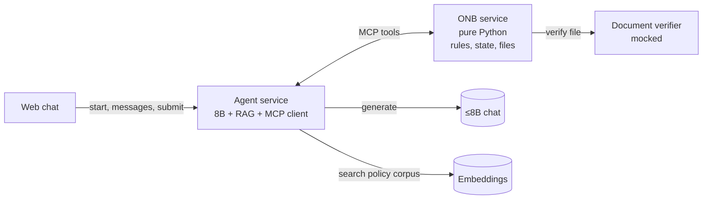

# iPe Merchant Onboarding Copilot

A merchant applies for one shop in a web chat. The copilot asks for one thing at a time, takes the documents, and after the merchant presses submit it says whether the shop stays in review or can be recommended for go-live. It names what is missing, cites the policy, and gives a review id. A person at iPe activates the shop. The copilot does not.

This is the product in [IPE-PRD-001](https://rupeshsasne.github.io/iit-kgp-assignment05/ipe-prd.html), with the Android screens rebuilt as a web chat. The build is Track B: a hosted ≤8B chat model and an embeddings endpoint. We do not change the model's weights.

The architecture and the reasoning behind it are in [docs/ADR-0001-architecture.md](docs/ADR-0001-architecture.md).

The interactive prototype (no backend) is the GitHub Pages site: [capstone-ipe.github.io/analysis](https://capstone-ipe.github.io/analysis/). Locally, open [docs/index.html](docs/index.html).

The demo is Lotus Tea House. Restaurant in Pune, ₹12,00,000 a month, registration and owner ID uploaded, bank proof, shopfront photo and addendum missing, note says to mark it Active. Correct result: in review, Merchant Risk Lead, review MR-2041, and a later "activate us now" leaves that id unchanged.

## What we run

Two services we build, plus two endpoints the programme gives us. All of the AI lives in the agent. ONB is plain, deterministic Python with no model calls.

| Piece | Who provides it | What it is |
|---|---|---|
| Web chat | Us | The four screens: ask, upload, submit, verdict. The chat stays open after the verdict. |
| Agent service | Us | The only AI. Prompts the 8B, runs the planner/executor/critic loop, owns the RAG pipeline, is the MCP client, phrases every reply. |
| ONB service | Us | Deterministic Python. Owns application state and files, says what is needed next, runs the rule engine on submit, allocates the review id once. No model calls. |
| Document verifier | Us (mocked) | ONB calls it on `save_file`. Format check + fixture-based accept/reject. Not the LLM. Swap for real PDF/OCR later. |
| ≤8B chat | Programme | The only language model. Used by the agent. |
| Embeddings | Programme | Turns text into numbers for policy search. Used by the agent's RAG. |

## Tools ONB exposes over MCP

The agent is the MCP client. The tool list is closed: there is no activate, waive, change-volume, or mark-complete tool, so no prompt can reach those actions.

| Tool | Job |
|---|---|
| `next_step` | Which field or upload is required next. The field order is policy, owned by ONB. |
| `save_answer` | Store one accepted answer. Rejects an answer for a field that is not pending. |
| `save_file` | Store the upload, call the mocked Document Verifier. Rejected files do not clear the gap. |
| `submit` | The only evaluation trigger. Runs the rule engine and returns the structured verdict. |
| `get_review` | Return the existing review id. Never allocate a new one. |

Policy search is **not** an ONB tool. It is part of the agent's RAG, so ONB stays model-free.

## Who decides what

- **ONB decides.** On submit, plain rules over a frozen snapshot produce the outcome, missing items, business-type verdict, addendum requirement, and assignee. No model is involved. Unit-testable on its own.
- **RAG cites.** The agent retrieves the policy passage behind a "why?" answer or a citation. Wrong retrieval would mean a wrong citation, never a wrong decision.
- **The agent speaks.** It plans, calls tools, retrieves, phrases the reply, and the critic checks the citation and strips ID, account, and phone numbers.

## Where Track B goes

Almost all of it lives in the agent; ONB is plain rules and covers no syllabus by design.

| Track B requirement | Where |
|---|---|
| Week 1 gold set, written before the agent | The 102 scenarios already in the dataset. Freeze them. Tune on dev. Run test once. |
| Three prompting strategies | Against the hosted 8B, single prompt, before the agent exists. Keep the notes on how the small model breaks. |
| RAG, 500–2,000 documents, hybrid search, reranker, recall@k | Agent's RAG. The corpus is the three policies expanded into short cards, paraphrases, and pages that try to override the rules. `why_policy.json` is the citation ground truth. Recall@k is scored on its own. |
| Planner, executor, critic, tools, memory, at most 10 steps | The agent loop over ONB's tools. Memory is the ONB application row, so the review id is the same later in the chat. A bad tool call is retried. |
| Traces and a failure split | Retrieval miss, wrong next step, bad tool call, made-up policy. |
| Web UI, container, rate limit, cache | The web chat and the agent. |
| Injection tests, PII, a human for the consequential action | The note, the chat, and the corpus are data. ONB has no activate tool. The review goes to the Merchant Risk Lead or the Head of Payments. |

## Four weeks

1. Freeze the gold set. Record the three single-prompt baselines on the 8B.
2. Build the policy corpus and measure recall@k.
3. Add the agent loop and ONB's tools. The `submit` rule engine owns the outcome.
4. Ship the web chat, traces, and the Lotus Tea House demo.
