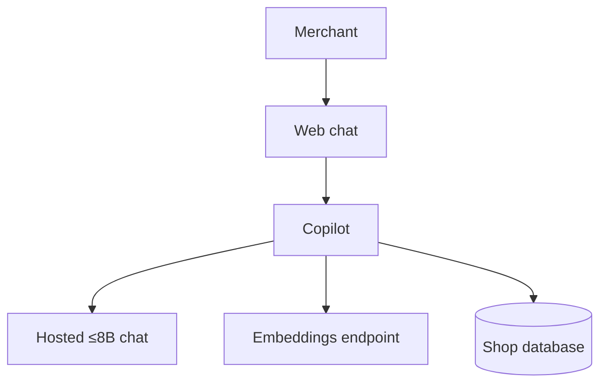

# iPe Merchant Onboarding Copilot

A merchant applies for one shop in a web chat. The copilot asks for one thing at a time, takes the documents, and after the merchant presses submit it says whether the shop stays in review or can be recommended for go-live. It names what is missing, cites the policy, and gives a review id. A person at iPe activates the shop. The copilot does not.

This is the product in [IPE-PRD-001](https://rupeshsasne.github.io/iit-kgp-assignment05/ipe-prd.html), with the Android screens rebuilt as a web chat. The build is Track B: a hosted ≤8B chat model and an embeddings endpoint. We do not change the model's weights.

The demo is Lotus Tea House. Restaurant in Pune, ₹12,00,000 a month, registration and owner ID uploaded, bank proof, shopfront photo and addendum missing, note says to mark it Active. Correct result: in review, Merchant Risk Lead, review MR-2041, and a later "activate us now" leaves that id unchanged.

## What we run

| Piece | Who provides it | What it is |
|---|---|---|
| Web chat | Us | The four screens: ask, upload, submit, verdict. The chat stays open after the verdict. |
| Copilot | Us | The Track B work. Prompts, policy search, and the agent. One service. |
| Shop database | Us | The application, the files, and the review id. |
| ≤8B chat | Programme | The only language model. Planner, executor, and critic all call it. |
| Embeddings | Programme | Used by policy search. |

The copilot is one service with four tools on that database. The tools are functions, not extra services.

| Tool | Job |
|---|---|
| Answers | Read and write the current field. Shop name, city, business type, monthly volume, UPI or cards, payer phones, note. |
| Files | Store the upload the merchant actually sent. Registration, owner ID, bank proof, shopfront photo, and the addendum when payer phones are stored. |
| Policy search | Find the policy passage for a "why" answer or a citation. |
| Verdict | Run only after submit. Apply ONB-POL-001, 002, and 003. Write the review id once. |

## Where Track B goes

All of it lives in the copilot, except the screens.

| Track B requirement | Where |
|---|---|
| Week 1 gold set, written before the agent | The 102 scenarios already in the dataset. Freeze them. Tune on dev. Run test once. |
| Three prompting strategies | Against the hosted 8B, single prompt, before the agent exists. Keep the notes on how the small model breaks. |
| RAG, 500–2,000 documents, hybrid search, reranker, recall@k | Policy search. The corpus is the three policies expanded into short cards, paraphrases, and pages that try to override the rules. Recall@k is scored on its own. |
| Planner, executor, critic, tools, memory, at most 10 steps | The copilot loop. Memory is the application row, so the review id is the same later in the chat. A bad tool call is retried. The critic checks the citation and strips ID, account, and phone numbers. |
| Traces and a failure split | Retrieval miss, wrong next step, bad tool call, made-up policy. |
| Web UI, container, rate limit, cache | The web chat and the copilot. |
| Injection tests, PII, a human for the consequential action | The note, the chat, and the corpus are data. The verdict tool has no activate action. The review goes to the Merchant Risk Lead or the Head of Payments. |

## Four weeks

1. Freeze the gold set. Record the three single-prompt baselines on the 8B.
2. Build the policy corpus and measure recall@k.
3. Add the loop and the four tools. The verdict tool owns the outcome.
4. Ship the web chat, traces, and the Lotus Tea House demo.
