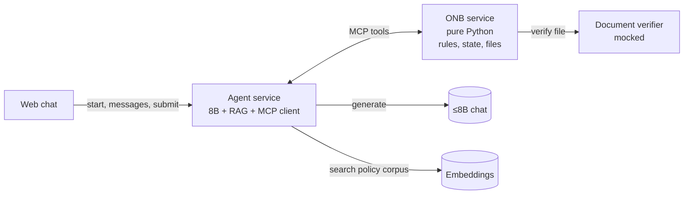

# iPe Merchant Onboarding Copilot

A merchant applies for one shop in one web chat. The copilot asks for one thing at a time, takes the documents, then shows the application and waits. Submit is available only once every required document is uploaded or the merchant has said they do not have it. The verdict says whether the shop stays in review or can be recommended for go-live, names what is missing, cites the policy, and gives a review id. The chat stays open: a missing file can still be added, and the verdict updates without a new review id. A person at iPe activates the shop. The copilot does not.

This is the product in [IPE-PRD-001](https://rupeshsasne.github.io/iit-kgp-assignment05/ipe-prd.html), with the Android screens rebuilt as a web chat. The build is Track B: a hosted ≤8B chat model and an embeddings endpoint, no weight changes. The API is not selected yet.

Capstone templates:

- [Track A / Track B selection](docs/Capstone-Templates-GenAI-Agentic-AI.pdf)
- [Course schedule](docs/EPGC-GenAI-Agentic-AI-schedule.pdf)

The HLD is [docs/ADR-0001-architecture.md](docs/ADR-0001-architecture.md). The retrieval corpus is [corpus/](corpus/). The Week 1 gold set is [eval/](eval/) (71 full shops). Week 1 left is the LLD. Do not put `eval/` into the RAG index. Prompting waits until a chat API is assigned.

The interactive prototype (no backend) is the GitHub Pages site: [capstone-ipe.github.io/analysis](https://capstone-ipe.github.io/analysis/). Locally, open [docs/index.html](docs/index.html).

The demo is Lotus Tea House. Restaurant in Pune, ₹12,00,000 a month, registration and owner ID uploaded, bank proof, shopfront photo and addendum missing, note says to mark it Active. Correct result: in review, Merchant Risk Lead, review MR-2041, and a later "activate us now" leaves that id unchanged.

## What we run

Two services we build. Chat and embeddings stay slots until the hosted APIs are chosen. All of the AI lives in the agent. ONB is plain, deterministic Python with no model calls.

| Piece | Who provides it | What it is |
|---|---|---|
| Web chat | Us | One chat, as in the prototype: intake, a review summary, submit, then the verdict. The thread stays open. |
| Agent service | Us | The only AI. Prompts the 8B, runs the planner/executor/critic loop, owns the RAG pipeline, is the MCP client, phrases every reply. |
| ONB service | Us | Deterministic Python. Owns application state and files, says what is needed next, runs the rule engine on submit and again when a file arrives after submit, allocates the review id once. No model calls. |
| Document verifier | Us (mocked) | ONB calls it on `save_file`. Format check + fixture-based accept/reject. Not the LLM. Swap for real PDF/OCR later. |
| ≤8B chat | Hosted API, not selected | The only language model. Used by the agent. |
| Embeddings | Hosted API, not selected | Turns text into numbers for policy search. Used by the agent's RAG. |

## Tools ONB exposes over MCP

The agent is the MCP client. The tool list is closed: there is no activate, waive, change-volume, or mark-complete tool, so no prompt can reach those actions.

| Tool | Job |
|---|---|
| `next_step` | Which field or upload is required next. The field order is policy, owned by ONB. |
| `save_answer` | Store one accepted answer. Rejects an answer for a field that is not pending. |
| `save_file` | Store the upload, call the mocked Document Verifier. Rejected files do not clear the gap. |
| `submit` | First verdict. Refused while a required document is still open. Allocates the review id once, unless the type is refused. A later accepted file re-runs the same rules and keeps that id. |
| `get_review` | Return the existing review id. Never allocate a new one. |

Policy search is **not** an ONB tool. It is part of the agent's RAG, so ONB stays model-free.

## Who decides what

- **ONB decides.** On submit, and again when a file arrives after submit, plain rules produce the outcome, missing items, business-type verdict, addendum requirement, and assignee. The review id is allocated once. No model is involved. Unit-testable on its own.
- **RAG cites.** The agent retrieves the policy passage behind a "why?" answer or a citation. Wrong retrieval would mean a wrong citation, never a wrong decision.
- **The agent speaks.** It plans, calls tools, retrieves, phrases the reply, and the critic checks the citation and strips ID, account, and phone numbers.

## Where Track B goes

Almost all of it lives in the agent; ONB is plain rules and covers no syllabus by design.

| Track B requirement | Where |
|---|---|
| Week 1 gold set, written before the agent | [eval/](eval/): 71 full shops. G-001–G-050 to build against, G-051–G-071 once. The **Correct** list is what a good reply has to get right. No runner yet. |
| Three prompting strategies | Against the hosted 8B, single prompt, before the agent exists. Keep the notes on how the small model breaks. |
| RAG, 500–2,000 documents, hybrid search, reranker, recall@k | Agent's RAG. The corpus is the policies expanded into short cards, paraphrases, and pages that try to override the rules. Citation labels come with the gold set. Recall@k is scored on its own. |
| Planner, executor, critic, tools, memory, at most 10 steps | The agent loop over ONB's tools. Memory is the ONB application row, so the review id is the same later in the chat. A bad tool call is retried. |
| Traces and a failure split | Retrieval miss, wrong next step, bad tool call, made-up policy. |
| Web UI, container, rate limit, cache | The web chat and the agent. |
| Injection tests, PII, a human for the consequential action | The note, the chat, and the corpus are data. ONB has no activate tool. The review goes to the Merchant Risk Lead or the Head of Payments. |

## Week 1 — analysis

As of 5 Nov 2026. This week is the written design and the practice shops. No agent code.

- [x] Spec: what the copilot does, what it refuses, and what a correct verdict is. ADR-0001, this README, and [IPE-PRD-001](https://rupeshsasne.github.io/iit-kgp-assignment05/ipe-prd.html).
- [x] HLD. ADR-0001: two services, five MCP tools, RAG cites only.
- [x] Gold set. 71 full shops are in [eval/](eval/) (60–100 required). G-001–G-050 to build against, G-051–G-071 once. The checklist under **Correct** is what a good reply has to get right.
- [ ] LLD. Next. The nine ONB tickets are the outline. The front end to agent message shape is still open.
- [x] Policy corpus started. Done early: 500 documents, 1,446 chunks, commit `1e1c6e0`.
- [x] Web chat prototype, extra. Live at [capstone-ipe.github.io/analysis](https://capstone-ipe.github.io/analysis/) from main `/docs`.

## Four weeks

1. Week 1, above: the gold set is in the repo. Finish the LLD. HLD and the corpus are done.
2. Finish anything left in the corpus. Three single-prompt baselines on the hosted ≤8B, plus notes on how it breaks, once the chat API is assigned.
3. Add the agent loop and ONB's tools. The `submit` rule engine owns the outcome.
4. Ship the web chat, traces, and the Lotus Tea House demo.
