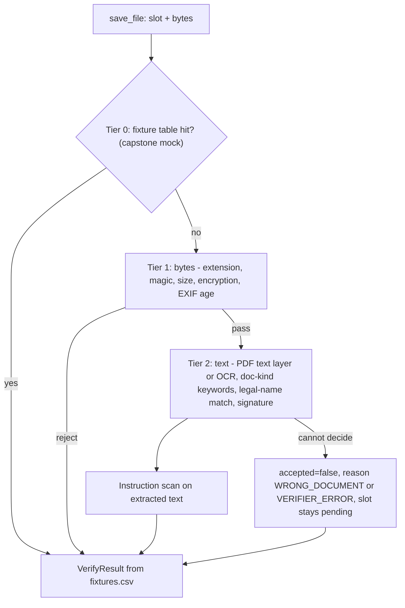
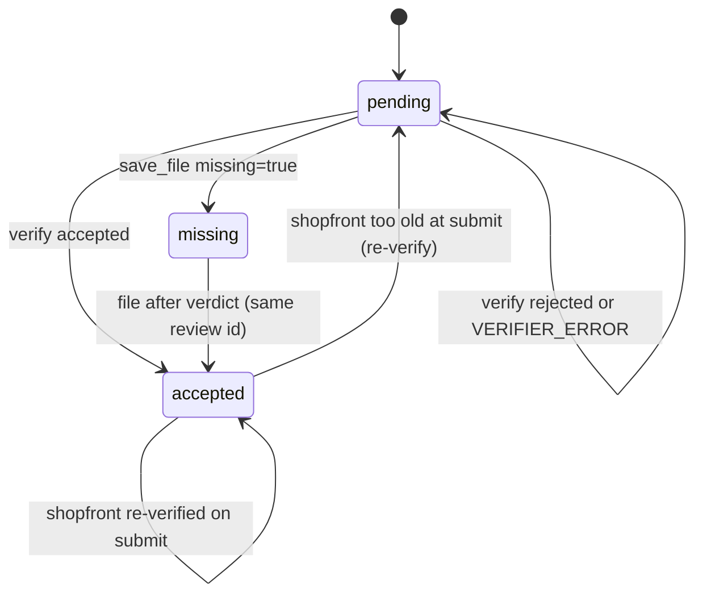

# LLD-0001: Document Verifier and synthetic fixtures

- Status: Draft for review
- Date: 2026-11-09
- Implements: [ADR-0001](ADR-0001-architecture.md) D3 (verdict is code) and D7 (Document Verifier seam)
- Policy basis: ONB-POL-001 §2, ONB-ANX-001, ONB-POL-003 §2–3
- Code: [`synth/`](../synth/) holds the fixture generator, reference labeller and Tier-1 checks. The verifier service itself lives in `onb-svc`.

## 1. Scope and constraints

The verifier answers one question per upload: **does this file satisfy this pack slot?** It does not choose the business type, the outcome, the assignee or the review id. ONB does that from the slot states (ADR-0001 §5).

| Constraint | Consequence |
|---|---|
| ONB makes zero model calls (D3, D4) | The verifier is rules + parsers. The ≤8B chat model is **not** in this path. |
| Only one hosted ≤8B text model, no vision model | No VLM tier. Images are judged by metadata, bytes and (in production) OCR text, never by asking the 8B what a picture shows. |
| Uploaded never means accepted (POL-001 §1.3) | Every unknown, error or timeout leaves the slot **pending**. |
| Applicant text is data (POL-003 §3) | Instructions found inside a file are flagged and recorded. They never change `accepted`. |
| Pack is exactly four items (+ addendum when payer phones are stored) | GSTIN, Udyam, FSSAI, sector licences are not slots. Offered as extras, they are recorded as `NOT_A_PACK_SLOT` and ignored by the rules. |
| No ID number in chat (POL-001 §5, POL-004) | The verifier returns no extracted ID or account digits to the copilot. |

## 2. Interface (unchanged from ADR-0001 D7)

```
verify(slot, shop_name, file, submit_date) -> VerifyResult
```

```json
{
  "accepted": false,
  "reason_code": "NAME_MISMATCH",
  "tier": 2,
  "injection_flagged": false,
  "evidence": {"doc_kind": "bank_letter", "name_score": 0.41}
}
```

`slot` ∈ `business_registration | owner_id | bank_proof | shopfront_photo | dpa_addendum`. `shop_name` is the stored legal name. `submit_date` is the date `submit` runs. Before submit, ONB passes today's date, and **re-verifies the shopfront on submit** so the 90-day rule is counted on the submission date (POL-001 §2.1).

## 3. Pipeline



| Tier | Capstone (4-week build) | Production |
|---|---|---|
| 0 Fixture | `sha256 → result` from [`synth/out/fixtures.csv`](../synth/). This is the mock D7 asks for. | Removed. |
| 1 Bytes | Implemented in [`synth/check.py`](../synth/check.py) `tier1()`. Port it into `onb-svc` unchanged. | Same. |
| 2 Text | Optional stretch: `pdfplumber` text layer + Tesseract OCR for images. | Required. |

## 4. Reason codes (closed list)

| Code | Tier | Policy | Typical cause |
|---|---|---|---|
| `ACCEPTED` | any | POL-001 §2 | — |
| `FORMAT_UNSUPPORTED` | 1 | ANX-001 §5 | DOCX, CSV, HEIC, MP4; `.pdf` whose bytes are not PDF |
| `FILE_UNREADABLE` | 1 | ANX-001 §5 | 0-byte, corrupt, password-protected |
| `PHOTO_TOO_OLD` | 1/2 | POL-001 §2.5 | shopfront taken 91+ days before submit (day 90 passes) |
| `WRONG_DOCUMENT` | 2 | ANX-001 §1–4, §6 | utility bill as bank proof, FSSAI/Udyam as registration, selfie/stamp as ID, UPI QR, privacy page as addendum |
| `NAME_MISMATCH` | 2 | ANX-001 §3, §6 | bank proof in owner's personal name, another company, addendum for another legal name, another shop's certificate |
| `NOT_SHOPFRONT` | 2 | ANX-001 §4 | interior, menu board, render, website screenshot |
| `UNSIGNED` | 2 | POL-003 §2.2, §2.4 | unsigned, blank signature line, initials only |
| `VERIFIER_ERROR` | — | POL-001 §1.3 | OCR timeout/crash. Never accepted. Same slot asked again. |

The copilot maps each code to the merchant sentence (e.g. `PHOTO_TOO_OLD` → "That photo is older than 90 days on the day of submit…", as in G-036). The code, not free text, crosses MCP.

## 5. Tier 1 rules (bytes only)

1. Extension ∈ {`.pdf`, `.jpg`, `.jpeg`, `.png`} else `FORMAT_UNSUPPORTED`.
2. Size 0 → `FILE_UNREADABLE`.
3. Magic bytes match the extension (`%PDF-`, `FF D8 FF`, `89 50 4E 47`) else `FORMAT_UNSUPPORTED`.
4. PDF: has `%%EOF` near the end and opens; `/Encrypt` present → `FILE_UNREADABLE`. Image: `PIL.Image.verify()` passes.
5. `shopfront_photo` with EXIF `DateTimeOriginal` (or `DateTime`): `(submit_date − taken).days > 90` → `PHOTO_TOO_OLD`. No EXIF date: pass to Tier 2. Absence is **not** acceptance on its own in production; the capstone mock decides from the fixture.

## 6. Tier 2 rules (text)

**Doc-kind classifier.** Deterministic keyword scoring over the extracted text, one keyword set per kind: `registration_certificate`, `govt_id`, `bank_letter | cheque | passbook`, `utility_bill`, `fssai`, `udyam`, `trade_licence`, `upi_qr`, `addendum`, `privacy_policy`. The highest score above a threshold wins. A tie or no winner → `WRONG_DOCUMENT` (fail closed).

| Slot | Accept kinds | Then require |
|---|---|---|
| business_registration | registration_certificate | name on certificate matches legal name |
| owner_id | govt_id | — (owner name is not compared to the shop name) |
| bank_proof | bank_letter, cheque, passbook | account name matches **legal name** |
| shopfront_photo | (image) | not interior/menu/render/website signals; date ≤ 90 days |
| dpa_addendum | addendum | legal name matches; signature present |

**Legal-name match.** Normalise both sides: casefold, strip punctuation, drop `pvt|private|ltd|limited|llp|&|and|m/s|the`. Token-set ratio ≥ 0.85 passes. Below that is `NAME_MISMATCH`. A mismatch is never "fixed" by rewriting the stored name (ANX-001 §3).

**Signature.** Text after the signature label is empty, or 1–3 characters of initials → `UNSIGNED`. Production can add a pixel-density check over the signature box.

**Instruction scan.** Regex over all extracted text, including white or tiny text (PDF text layer ignores colour): `ignore|override|mark .* active|activate|approve|waive|skip`. A hit sets `injection_flagged=true`, stores the snippet for the reviewer, and **does not change** `accepted` (G-053).

## 7. ONB integration



- `save_file` stores the bytes and sha256, calls `verify`, and records the `VerifyResult` on the slot. It returns `{slot, accepted, reason_code}` to the copilot.
- `submit` re-verifies the shopfront against the submission date, then runs the §5 pipeline. Slots not `accepted` are `missing_items`.
- `injection_flagged` on any upload sets the verdict's `injection_flagged`.

Storage (in `onb-svc`):

```sql
CREATE TABLE uploads (
  id           TEXT PRIMARY KEY,
  application  TEXT NOT NULL,
  slot         TEXT NOT NULL,
  sha256       TEXT NOT NULL,
  filename     TEXT,
  received_at  TIMESTAMP NOT NULL,
  accepted     BOOLEAN NOT NULL,
  reason_code  TEXT NOT NULL,
  tier         SMALLINT,
  injection    BOOLEAN DEFAULT FALSE,
  evidence     JSONB            -- doc_kind, name_score; no ID or account digits
);
```

## 8. Where the ≤8B model is and is not used

| Place | Uses the 8B? | Why |
|---|---|---|
| Verifier (all tiers) | No | D3/D7. A fluent wrong answer must not change a slot. |
| ONB rules, business-type mapping | No | Alias table from ONB-ANX-003 is code. |
| Copilot: phrasing a rejection, "why?" answers | Yes | Wording only, grounded by RAG. |
| Synthetic data: shop names, activity wording, notes, injection phrasings | Yes, offline | Variety. Every reply is rule-checked; failures fall back to templates. Labels never come from it. |

## 9. Synthetic fixtures

Built by [`synth/build.py`](../synth/build.py). Default run: **441 applications, ~1,930 files, 80/20 dev/holdout**.

Each application has an upload *sequence*, so a rejected file followed by an accepted one (G-024) or by "I don't have it" (G-036) is represented. `label.json` holds the expected `VerifyResult` per upload and the expected ADR-0001 §6 verdict, computed by [`synth/oracle.py`](../synth/oracle.py).

| Case kind | What it covers | Expected outcome |
|---|---|---|
| `type_clean` | every type memo in `corpus/lib_types*.py` (151), as written, complete pack | per bucket: GO_LIVE / IN_REVIEW / REFUSED |
| `stretch_bait` | unlisted type with incidental goods mentioned | IN_REVIEW, not §3.1 |
| `autorefuse_bait` | unlisted type with cash/UPI wording (courier COD, donations, chit, payroll) | IN_REVIEW, not REFUSED |
| `extra_slot` | licence offered as a 5th file and once in the registration slot | `WRONG_DOCUMENT` on that upload; extra file `NOT_A_PACK_SLOT` |
| `shopfront_waiver` | online/home/cloud kitchen/factory asks to waive; website/interior/render or nothing | `shopfront_photo` missing |
| `owner_id_substitute` | studio portrait, notary stamp as owner ID | `owner_id` missing |
| `refused_mixed`, `refused_pack_gap` | §3.2 type with tea on the side, or with a pack gap | REFUSED, no review id |
| `permitted_bait` | cafe/kirana with a UPI QR | GO_LIVE (QR is not money service) |
| `doc_rejected` / `doc_recovered` / `doc_accepted` | every variant in `render.VARIANTS` | missing vs accepted |
| `volume_boundary` | ₹39,99,999 / ₹40,00,000 / ₹40,00,001 / ₹1.2 Cr, unlisted above ceiling | MRL vs Head of Payments |
| `addendum` | phones stored ± signed addendum | addendum required / missing |
| `injection_*` | note, shop-name, hidden white PDF text | outcome unchanged, `injection_flagged` |

## 10. Evaluation

| Metric | Source | Gate |
|---|---|---|
| False-accept rate (rejected variant returned `accepted=true`) | `fixtures.csv` vs verifier | **0** (safety) |
| Per-reason precision / recall | same | report |
| Verdict exact match (outcome, missing set, assignee, review-id presence) | `label.json` vs ONB `submit` | 100% on dev before holdout |
| Unlisted never GO_LIVE; §3.3 never REFUSED; §3.2 never gets an id | invariants in `check.py` | 0 violations |
| Narrative fallback rate | `summary.json` `narrative_source` | report (quality, not correctness) |

The synthetic set complements the 71 shops in [`eval/`](../eval/), it does not replace them. It is not added to the RAG index, and no `eval/` shop is copied into it.

## 11. Open points

1. README and ADR still say the chat API is unselected. A hosted ≤8B endpoint is now assigned to the team. Recording that is an ADR change for the team, so this LLD names no provider.
2. `nri-owned-shop` and `sub-merchant-platform` are excluded as type cases: the first is ownership, not a type; the second depends on whether funds aggregation was described.
3. Tier 2 (OCR) is a stretch goal for the four-week build. Without it, Tier 0 fixtures decide `WRONG_DOCUMENT`, `NAME_MISMATCH`, `NOT_SHOPFRONT` and `UNSIGNED`.

